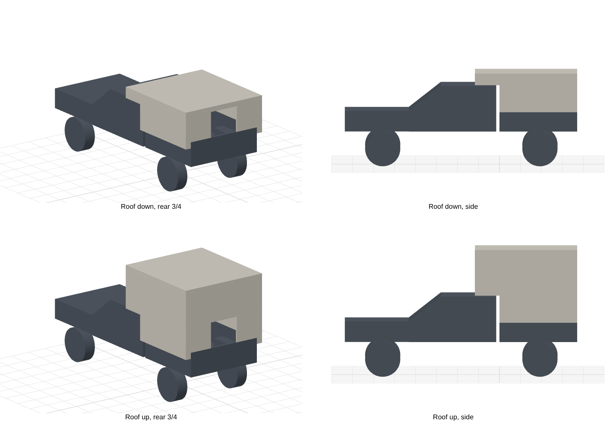

# Tune M1-style camper on a Silverado 1500, 5'8" box

A full-size massing model for planning fit and clearances: overall height
with the roof down and up, width past the truck body, cab-over clearance and
sleeping-platform headroom. The truck and camper are simplified blocks. It
isn't a manufacturing drawing.



## Files

| File | What it is |
|---|---|
| `tune_on_silverado_closed.step` | Truck and camper with the roof down. Opens in Fusion. |
| `tune_on_silverado_open.step` | Truck and camper with the roof up. |
| `clearances.txt` | Key dimensions, recomputed on every run. |
| `camper.py` | The model. Every dimension is a named parameter. |

## Current numbers (from estimates, see below)

```
Overall height, roof down             87.5 in  ( 2.22 m)
Overall height, roof up              119.6 in  ( 3.04 m)
Shell width                           88.4 in  ( 2.25 m)
Shell width minus truck body width     7.2 in  ( 0.18 m)
Cab-over length (past bed front)      23.0 in  ( 0.58 m)
Bed floor to roof, popped up          82.0 in  ( 2.08 m)
Platform top to roof, popped up       36.6 in  ( 0.93 m)
Bed floor to platform underside       43.4 in  ( 1.10 m)
```

## Which numbers are real

Parameters marked **PUBLISHED** come from published specs:
- **Tune:** 60 × 78" sleeping platform, 6" overhang past the bed sides, and
  "nearly 7 ft" of headroom.
- **Silverado:** 69.9" bed floor length and 50.6" between the wheel wells.

Parameters marked **MEASURE** are estimates. The ones that move the answers
most are:

| Parameter | Why it matters | Estimate |
|---|---|---|
| `RAIL_Z`, `CAB_ROOF_Z` | Ground to bed rail and to cab roof on **your** truck (trim, 4x4, tires and any lift change these) | 57", 75.5" |
| `CABOVER_L` | How far the camper runs over the cab | 20" |
| `CAB_CLEAR`, `MATTRESS_T`, `PLATFORM_T` | Together these set the roof-down height | 1", 4", 2" |
| `HEADROOM` | Sets the roof-up height | 82" |
| `BED_IN_W`, `RAIL_W` | Set the shell width | 71.4", 2.5" |

The best source is Tune's fit sheet for your truck (they build to the
specific bed). Measure the truck parameters at your truck with a tape. Edit
the values, then run:

```
pip install build123d
python3 camper.py .
THREE_DIR=<node_modules/three> node render.js .   # preview.png
```

The script checks that no camper part overlaps the truck, and stops with an
error if one does.

## Common checks

- **Garage and drive-thru clearance:** compare "overall height, roof down"
  with the door height. Add any roof rack or solar on top.
- **Mirrors:** the shell is about 7" wider than the body. Compare the
  per-side overhang (half of that) with your mirror reach.
- **Sitting up in bed:** "platform top to roof, popped up" minus the mattress
  gives seated headroom.
