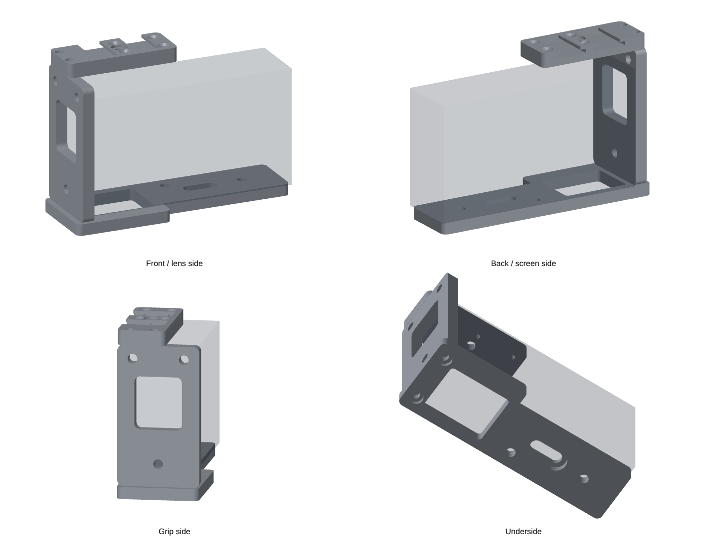

# Sony ZV-E10 full cage (machined plates)

A cage made of four flat 6061 plates, sized to cut on a Makera Z1
(200 × 200 mm bed).

- **base:** camera plate with a 1/4"-20 camera screw slot and a battery/SD
  door cutout.
- **upright:** plate on the grip side.
- **top bar:** sits along the back of the camera top, with two cold shoe
  channels.
- **shoe cap:** thin plate on top of the top bar that forms the cold shoe
  rails.

The screen-hinge/port side and the hot shoe stay open.



## Measure first

Sony publishes the body size (115.2 × 64.2 × 44.8 mm, grip to monitor), but
not where the features are. The values marked `MEASURE` at the top of
`cage.py` are estimates. Check them with calipers, edit them, and run
`python3 cage.py .` again.

Measure X from the **screen-hinge end** of the body and Y from the **back
face of the LCD**:

| Parameter | What to measure | Estimate |
|---|---|---|
| `BODY_D` | Back of LCD to the front of the body shell (not the grip) | 34 mm |
| `TRIPOD_X`, `TRIPOD_Y` | Center of the tripod socket | 44, 17 mm |
| `BATT_X`, `BATT_Y` | Outline of the battery/SD door, including its swing | 76–112, 4–32 mm |
| `LUG_Z` | Height range of the grip-side strap lug (the upright has a window for it) | 30–58 mm |
| `HOTSHOE_X` | Center of the hot shoe (the top bar starts 16 mm to its right) | 44 mm |
| `LENS_CLEAR_X` | Where the base can start running deeper under the grip without hitting the lens | 72 mm |

Cut a test fit first. Use MDF or plywood on the Z1, or print the STEP files,
and check that the camera seats, the battery door opens and the strap lug
clears before cutting aluminum.

## Parts and hardware

| Item | Qty |
|---|---|
| 1/4" (6.35 mm) 6061 plate: base 125 × 43, upright 43 × 74, top bar 62 × 25 mm | 1 piece, about 130 × 160 mm |
| 1/16" (1.6 mm) 6061 sheet: shoe cap 62 × 25 mm | 1 |
| 1/4"-20 × 5/16" button head screw (the camera screw; it sticks up about 5.2 mm, inside Sony's 5.5 mm limit) | 1 |
| M4 × 12 button head screws, base to upright | 2 |
| M4 × 16 button head screws, cap + top bar to upright | 2 |
| M3 × 8 flat head screws, cap to top bar | 4 |
| Taps: 1/4"-20, M4, M3 | |

**Tapped holes.** The parts are modeled with tap-drill-size holes: 5.1 mm for
1/4"-20, 3.3 mm for M4, 2.5 mm for M3. Tap them by hand after machining.
- **Top bar:** one 1/4"-20 hole between the cold shoes, plus four M3 holes for
  the cap.
- **Upright:** three 1/4"-20 holes.
- **Base:** two 1/4"-20 holes. Both sit under the camera, so use screws
  **no longer than 1/4"** in them, or they will hit the camera body.

## Machining on the Z1 (Fusion)

Import each part's STEP (`base.step`, `upright.step`, `top_bar.step`,
`shoe_cap.step`). Every part is modeled lying flat, ready for a Fusion setup.

- **Tools:** a 1/8" (3.175 mm) single-flute endmill for profiles, pockets and
  holes of 3.3 mm and up. The 2.5 mm M3 holes need a 1/16" endmill, or spot
  them on the Z1 and drill them by hand.
- **Feeds:** the Z1 spindle is small (150 W, 13,000 RPM), so keep cuts light.
  Start around 10 ipm with 0.25 mm (0.010") stepdowns, and use a drop of
  WD-40 or alcohol on the cut.

**Base (two setups)**
1. Top face up: pocket the counterbores and profile the outline. Hold the
   plate with tape or CA glue, or use tabs.
2. Flip it: pocket the button-head counterbores on the underside. These are
   the 11.8 mm camera screw slot and the two 8.2 mm M4 holes.

**Upright, top bar and cap (one setup each)**
- **Top bar:** the cold shoe channels (18.8 wide × 2.2 deep) are pockets open
  at the back edge. Cut them in the same setup as the profile.

**Edge holes (hand work)**
The M4 screws go into the upright's **bottom and top edges**. Clamp the
upright to the base, square, and drill through the base's M4 holes into the
upright's edge with a 3.3 mm drill. Then tap M4, about 10 mm deep. Do the same
from the top bar's M4 holes.

## Assembly

1. Screw the upright to the base: two M4 × 12 screws from underneath.
2. Stack the shoe cap on the top bar, then screw both to the top of the
   upright with two M4 × 16 screws. Add the four M3 flat heads.
3. Put the camera screw up through the slot, from underneath. Slide the
   camera against the upright and tighten.

**Cold shoes:** an accessory slides in from the back and stops against the
front wall. There's no spring, so use accessories with a locking foot.

## Regenerating

```
pip install build123d
python3 cage.py .                       # STEP for each part, assembly STEP/STL
THREE_DIR=<node_modules/three> node render.js .   # preview.png
```
